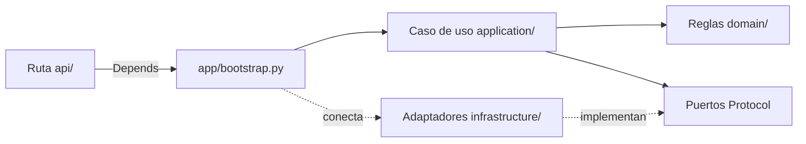

# NEXUS ERP · Login · login-02-base · v1

| Campo | Valor |
|---|---|
| Tarea | `login-02-base` (parte 1 del módulo de Login: base del backend) |
| Versión | v1 |
| Fecha | 2026-11-20 |
| Estado | **Propuesta para revisión** |
| Rama / PR | `worktree/claude_worktree` · sin PR |
| Reemplaza a | — (primera versión) |
| Fuente en el repositorio | `docs/iterations/login-02-base/claude.md` (secciones 0 a 11) |

> Nota de trazabilidad: esta página se redactó el 2026-11-20 en `docs/notion/` porque la sesión no tenía conector de Notion. Refleja la propuesta tal como se presentó, antes de las aprobaciones.

## 1. Cambios respecto a la versión anterior

Primera versión.

## 2. Reemplazo de `login-01` por el ER v2 (pendiente de confirmar, C-01)

| Tema | `login-01` | Vigente (ER v2) |
|---|---|---|
| Base de datos | PostgreSQL 16 + asyncpg | Una sola base MySQL; driver según D-02 |
| Token | Cookie HttpOnly | `Authorization: Bearer` (la cookie sigue abierta, D-04) |
| Esquema | 4 tablas | 7 tablas del ER v2 (`login-04-migracion`) |
| IDs | `uuid` | `BIGINT` en catálogo; `BINARY(16)` UUIDv7 en sesiones y conexiones |
| Correo | `citext` | Normalizado en el dominio; colación `utf8mb4_bin` |
| Contraseñas | Diferidas | Fuera del alcance: LOG-12, LOG-13 y CA-08 retirados |
| Códigos de error | `INVALID_CREDENTIALS` | `snake_case`: `invalid_credentials` |

Sigue vigente de `login-01`: las capas, `SessionOpener`, problem+json, `usuario_multitenant` derivado y el token opaco de 256 bits del que solo se guarda el hash.

## 3. Objetivo y alcance

**Objetivo:** un esqueleto ejecutable para las partes 2 a 9. Lo forman la fábrica de la app, la configuración por ambiente, la conexión MySQL, los errores problem+json, el reloj UTC, Alembic sin migraciones, el punto de composición, las reglas de calidad y la regla de importación entre capas.

**Fuera del alcance:** entidades, puertos y políticas (`login-03`), tablas y repositorios (`login-04`), endpoints de autenticación (`login-05` en adelante) y las pruebas unitarias, que escribe Codex.

## 4. Reglas y casos: trazabilidad regla → componente → prueba

Esta parte no implementa reglas LOG ni casos CA. Prepara las condiciones técnicas que exigen después:

| Origen | Componente propuesto | Prueba o verificación prevista |
|---|---|---|
| LOG-16 (vigencia comparada en UTC) | `core/db.py` (`time_zone '+00:00'`), `core/clock.py` | T-07, AC-07 |
| Todas las reglas que rechazan (`code` estable) | `core/errors.py` | T-03 a T-06 |
| CLAUDE.md (dominio puro, capas) | Contratos de `import-linter` | AC-04 |
| Instrucción §8 (el token nunca en logs) | Filtro de `core/logging.py` | T-10 |

## 5. Diseño

- **Capas:** `app/core/` compartido; `app/identity/login/{api,application,domain,infrastructure}/` creados vacíos para que la regla de importación rija desde el inicio.
- **Patrón:** fábrica de la app (`create_app`) y raíz de composición (`app/bootstrap.py`). Permite crear apps de prueba sin estado global y deja `bootstrap.py` como único importador de `infrastructure/`. Sin contenedor de inyección de dependencias, pipeline ni orquestador.
- **Acceso a datos (D-02, abierta):** opción A, async con `asyncmy` (recomendada por la presencia WebSocket y el SSO), u opción B, sync con `PyMySQL`.



**Archivos propuestos:**
- Raíz: `pyproject.toml`, `uv.lock`, `.python-version`, `.gitignore`, `.env.example`, `README.md`, `docker-compose.yml`, `alembic.ini`.
- Alembic: `alembic/{env.py,script.py.mako,versions/}`.
- `app/`: `main.py`, `bootstrap.py`, `core/{config,db,errors,clock,logging,health}.py`.
- `tests/`: `conftest.py`.

## 6. Contrato

| Ruta | Respuesta |
|---|---|
| `GET /api/v1/health` | `200 {"status":"ok"}` |
| `GET /api/v1/health/ready` | `200 {"status":"ready","database":"ok"}` o `503 service_unavailable` |

Errores comunes en problem+json: `validation_error` 422, `bad_request` 400, `not_found` 404, `method_not_allowed` 405, `service_unavailable` 503 e `internal_error` 500.

```json
{"type":"about:blank","title":"No encontrado","status":404,"code":"not_found","detail":"La ruta solicitada no existe."}
```

Sin eventos WebSocket en esta parte.

## 7. Interfaces internas para Codex

- `create_app(settings=None)`.
- `Settings` y `get_settings()`.
- `register_error_mapping(mapping)` y `ErrorSpec(status, code, title)`.
- `SystemClock.now()`.
- Doble `FixedClock(at).advance(delta)`.
- Fixtures `settings_test`, `app` y `client`.
- Escenarios T-01 a T-10 (validaciones de configuración, formato de errores, reloj, salud y filtro de logs).

## 8. Cambios de datos

Ninguno. Alembic queda configurado sin revisiones; la `0001` corresponde a `login-04-migracion`.

## 9. Verificaciones ejecutadas

Ninguna: es una propuesta. Las previstas son de AC-01 a AC-09 (instalación, ruff, mypy, `lint-imports`, pytest, Alembic de ida y vuelta, arranque, rechazo de MySQL inadecuado y nada sensible en Git).

## 10. Decisiones abiertas y riesgos

- **Pendientes de aprobación:** C-01 (reemplazo ER v2), C-02 (alcance), D-01 (dependencias) y D-02 (async o sync).
- **Confirmaciones:** C-03 a C-08 (área `identity`, `docker-compose`, endpoints de salud, `.DS_Store`, `/docs` en producción, logs JSON).
- **Preguntas:** Q-01 (acceso a las páginas de Notion del ER v2) y Q-02 (versión de MySQL por ambiente).
- **Inconsistencias:** I-01 (las reglas aún listan LOG-12, LOG-13 y CA-08), I-02 (`docs/ai/` frente a `docs/agents/`) e I-03 (la instrucción de Claude no está versionada).
- **Riesgo:** los drivers async de MySQL tienen menos uso que PyMySQL; hay que revisar el mantenimiento de `asyncmy` antes de aprobar.
