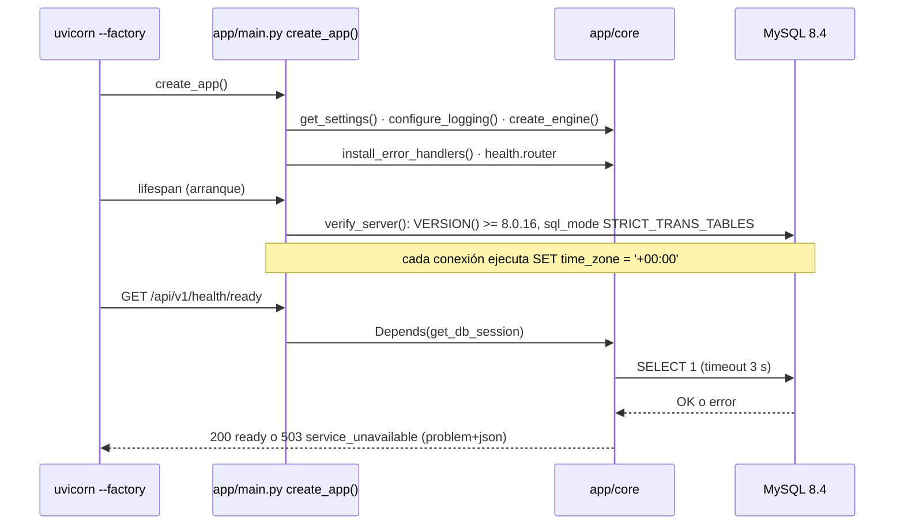

# NEXUS ERP · Login · login-02-base · v2

| Campo | Valor |
|---|---|
| Tarea | `login-02-base` (parte 1 del módulo de Login: base del backend) |
| Versión | v2 |
| Fecha | 2026-11-20 |
| Estado | **Implementado, pendiente de revisión** |
| Rama / PR | `worktree/claude_worktree` · sin commits ni PR, por instrucción del responsable |
| Reemplaza a | `NEXUS ERP · Login · login-02-base · v1` |
| Fuente en el repositorio | `docs/iterations/login-02-base/claude.md`, sección "Registro de entrega" |

## 1. Cambios respecto a v1

- **Aprobaciones del responsable (2026-11-20):**
  - C-01: reemplazo por el ER v2.
  - C-02: alcance y archivos, con la tabla de dependencias (D-01 para esta parte) y las opciones C-03 a C-08 tal como estaban propuestas.
  - D-02: async con `asyncmy`.
  - D-11: `cryptography`, una dependencia nueva surgida al verificar.
- Implementación completa de la propuesta, con estas diferencias:
  - `register_error_mapping(app, mapping)`: recibe la app y evita un registro global.
  - `docker-compose.yml` crea solo la base `nexus`; `nexus_test` queda para la tarea de integración.
  - Ruff excluye `docs/`, porque la versión 0.17 también formatea los bloques de código de los Markdown.
  - Se agregó `cryptography` (D-11).
- Verificaciones ejecutadas con resultados reales (sección 9).
- Hallazgos nuevos: H-01, resuelto con D-11, y D-12, abierta.

## 2. Objetivo y alcance

Sin cambios respecto a v1. El ER v2 sigue vigente en los términos de v1, sección 2 (C-01 aprobado).

## 3. Reglas y casos: trazabilidad regla → componente → prueba

| Origen | Componente entregado | Verificación |
|---|---|---|
| LOG-16 (vigencia en UTC) | `app/core/db.py` (`SET time_zone = '+00:00'` en cada conexión), `app/core/clock.py` | T-07 OK; `@@SESSION.time_zone = +00:00` contra MySQL 8.4.13 |
| `code` estable en rechazos | `app/core/errors.py` | T-03 a T-06 OK (script de humo) |
| CLAUDE.md (capas, dominio puro) | 4 contratos de `import-linter` en `pyproject.toml` | `4 kept, 0 broken`; un control negativo los rompe |
| Instrucción §8 (token fuera de los logs) | `RedactAuthorizationFilter` en `app/core/logging.py` | T-10 OK |

Las pruebas unitarias definitivas las escribe Codex en `tests/core/`.

## 4. Diseño entregado



| Pieza | Archivo | Detalle |
|---|---|---|
| Entrada | `app/main.py` | `create_app(settings=None)`; `lifespan` verifica MySQL y libera el engine. |
| Composición | `app/bootstrap.py` | `get_settings`, `get_db_session` y `get_clock`; aquí se agregarán los casos de uso. |
| Configuración | `app/core/config.py` | Prefijo `NEXUS_`; `.env` solo en `local`; exige `mysql+asyncmy://`; en producción no permite `docs_enabled` ni `db_echo` y no admite `cors_origins` con `"*"`. |
| Base de datos | `app/core/db.py` | Engine async, pool con `pre_ping` y `recycle`, convención de nombres de restricciones, `import_models()` para Alembic. |
| Errores | `app/core/errors.py` | problem+json, `ErrorSpec` y registro por módulo. |
| Reloj | `app/core/clock.py` | UTC consciente de zona, truncado a ms (`DATETIME(3)`). |
| Logs | `app/core/logging.py` | Texto en `local` y JSON en el resto; oculta los tokens `Authorization`/`Bearer`. |
| Salud | `app/core/health.py` | Liveness y readiness. |
| Migraciones | `alembic/env.py` | Modo async con `run_sync`; URL tomada de `Settings`; revisiones con `--rev-id`. |
| Calidad | `pyproject.toml` | ruff (E, F, I, UP, B, S, ASYNC), mypy estricto en base, dominio y aplicación, pytest con `asyncio_mode = "auto"` e `import-linter`. |

**Patrón:** fábrica de la app y raíz de composición, sin cambios respecto a v1.

## 5. Contrato

Igual que en v1 (salud y errores comunes). Ejemplo real de la verificación:

```http
GET /api/v1/health/ready  →  200 {"status":"ready","database":"ok"}
GET /api/v1/nada          →  404 {"type":"about:blank","title":"No encontrado","status":404,"code":"not_found","detail":"La ruta solicitada no existe."}
```

## 6. Interfaces internas para Codex

| Interfaz | Ubicación |
|---|---|
| `create_app(settings: Settings \| None = None) -> FastAPI` | `app/main.py` |
| `Settings`, `load_settings()`, `get_settings()` | `app/core/config.py` |
| `register_error_mapping(app, mapping)`, `ErrorSpec(status, code, title)`, `problem_response(spec, detail=None, *, errors=None, headers=None)`, `ServiceUnavailable` | `app/core/errors.py` |
| `SystemClock.now()` | `app/core/clock.py` |
| `check_server(version, sql_mode)`, `get_db_session` | `app/core/db.py` |
| `RedactAuthorizationFilter`, `redact()` | `app/core/logging.py` |
| `FixedClock(at)`, `.advance(delta)` | `tests/fakes.py` |
| Fixtures `settings_test`, `app`, `client` (sin lifespan; URL a un puerto cerrado) | `tests/conftest.py` |

Notas para las pruebas:
- T-05: usar `TestClient(app, raise_server_exceptions=False)`.
- T-09: sustituir `get_db_session` por una sesión cuyo `execute` lance `SQLAlchemyError`.

## 7. Cambios de datos

Ninguna tabla. `alembic upgrade head` solo crea `alembic_version`.

## 8. Dependencias

Fijadas en `uv.lock`:
- Ejecución: fastapi 0.165.0, starlette 1.10.0, pydantic 2.14.4, pydantic-settings 2.16.3, sqlalchemy 2.1.9, asyncmy 0.2.18, cryptography 50.0.2, alembic 1.20.1, uvicorn 0.54.0.
- Desarrollo: pytest 9.2.0, pytest-asyncio 1.5.0, httpx 0.28.1, ruff 0.17.6, mypy 2.4.1, import-linter 2.17.
- Python 3.12.14, gestionado por uv.

## 9. Verificaciones ejecutadas y resultados reales

| # | Verificación | Resultado |
|---|---|---|
| AC-01 | `uv sync` | OK. |
| AC-02 | ruff check y ruff format | OK, tras corregir un import largo en `db.py`. |
| AC-03 | `mypy app` | OK (16 archivos). |
| AC-04 | `lint-imports` | OK, 4 de 4. Un import prohibido temporal lo rompe, como se esperaba. |
| AC-05 | `pytest` | 0 pruebas recolectadas (son de Codex). Script de humo T-01…T-10 y casos adicionales: **24/24 OK**. |
| AC-06 | Alembic de ida y vuelta en MySQL 8.4.13 (contenedor desechable) | OK. Con `cryptography`, funciona sin precargar la caché de autenticación. |
| AC-07 | Arranque con uvicorn | OK: health 200, ready 200, `/docs` 200, 404 problem+json. |
| AC-07 | Reconexión tras reiniciar MySQL (riesgo H-01) | OK, con `time_zone +00:00`. |
| AC-08 | Rechazo de MySQL < 8.0.16, sin modo estricto o MariaDB | OK (función `check_server`). |
| AC-09 | Nada sensible en Git | OK: `.env`, `.venv/`, `.DS_Store` y `__pycache__` quedan ignorados. Los `.DS_Store` versionados salieron del índice. |

## 10. Decisiones abiertas y riesgos

| ID | Tema | Estado |
|---|---|---|
| H-01 / D-11 | Autenticación `caching_sha2_password` sin TLS | **Resuelto:** `cryptography` aprobado y agregado. Queda como recomendación usar TLS hacia MySQL en staging y producción (tarea aparte). |
| D-12 | Starlette 1.10 depreca `httpx` en su `TestClient` y sugiere `httpx2` | Abierta. Por ahora es solo un aviso; decidir antes de que crezcan las pruebas. |
| Q-01 | Acceso a las páginas de Notion del ER v2 | Abierta. Bloquea `login-03-dominio` y `login-04-migracion`. |
| Q-02 | Versión de MySQL por ambiente | Abierta. |
| I-01, I-02, I-03 | Reglas con LOG retirados, ubicación de guías, instrucción sin versionar | Abiertas (ver v1). |
| Riesgo | Sin commits, todo el trabajo existe solo en el árbol de trabajo del worktree | Mitigación: commit y PR cuando el responsable los autorice. |
