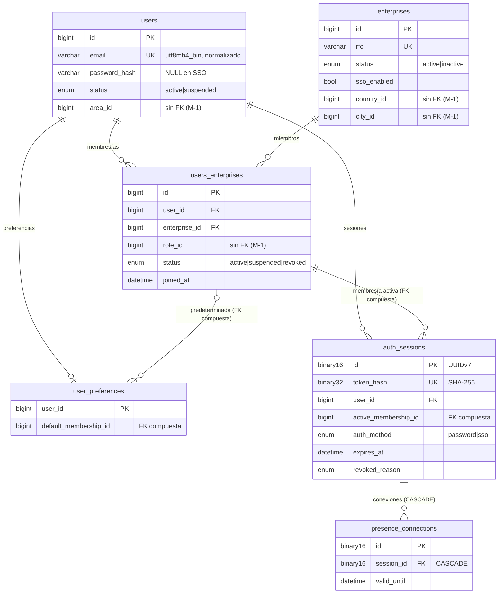

# NEXUS ERP · Login · login-04-migracion · v1

| Campo | Valor |
|---|---|
| Tarea | `login-04-migracion` (parte 3 del módulo de Login: modelos de persistencia y migración `0001`) |
| Versión | v1 |
| Fecha | 2026-11-20 |
| Estado | **Aprobada** (decisiones M-1 a M-5 resueltas por el responsable) |
| Rama / PR | `worktree/claude_worktree` · sin PR |
| Reemplaza a | — (primera versión) |
| Fuente | `docs/agents/herdr-login-04-migraciones.md` (sección 5) y `docs/iterations/login-04-migracion/claude.md` |

> Nota de trazabilidad: el responsable resolvió M-1 a M-5 y autorizó iniciar `login-04` antes de `login-03-dominio` el 2026-11-20. Esta página se redactó en `docs/notion/` (sin conector de Notion), junto con la entrega (v2). Codex aún no revisó la propuesta.

## 1. Cambios respecto a la versión anterior

Primera versión.

## 2. Objetivo y alcance

**Objetivo:** modelos de persistencia de SQLAlchemy 2.0 para las tablas de Login y migración reversible `0001` en MySQL 8.4.

**Dentro del alcance:** `users`, `enterprises`, `users_enterprises`, `user_preferences`, `auth_sessions` y `presence_connections`.

**Fuera del alcance:**
- `enterprise_sso_config` (M-3).
- Repositorios, unidad de trabajo, casos de uso, endpoints y datos semilla.
- Tablas de contraseñas (LOG-12, LOG-13 y CA-08 retirados) y catálogos del ERP.

## 3. Diagrama ER propuesto

## 4. Tablas, restricciones y reglas

Especificación completa en `herdr-login-04-migraciones.md`, sección 5. Las restricciones clave:

| Restricción | Regla |
|---|---|
| `uq_users_email` y `ck_users_email_normalized` | LOG-07, M-5 |
| `uq_users_enterprises_user_id_enterprise_id` | LOG-07, CA-05 |
| `ix_users_enterprises_user_id_status_joined_at` | LOG-05 |
| FK compuesta `user_preferences → users_enterprises(id, user_id)` | LOG-04, LOG-05 |
| FK compuesta `auth_sessions → users_enterprises(id, user_id)` | LOG-16, CU-06 |
| `uq_auth_sessions_token_hash` | Instrucción general §3.1 |
| `ck_auth_sessions_revocation_consistent` y `ck_auth_sessions_expires_after_created` | LOG-14, LOG-16 |
| `fk_presence_connections_session_id_auth_sessions` (CASCADE) | CU-10 |

## 5. Decisiones

| ID | Decisión | Estado |
|---|---|---|
| M-1 | Sin FK hacia catálogos inexistentes, con índice | **Aprobada** |
| M-2 | `status` como ENUM; retirar `me`, `id_sso`, `status_id` y `account_status` | **Aprobada** |
| M-3 | Diferir `enterprise_sso_config` a `login-07-sso` | **Aprobada** |
| M-4 | Longitudes de los `VARCHAR` | **Aprobada: 255 en todos por ahora** |
| M-5 | `ck_users_email_normalized` | **Aprobada** |

## 6. Verificaciones previstas

V-01 a V-10 de la instrucción: lint, tipos, regla de importación, SQL sin base, longitud de nombres, ida y vuelta, `alembic check`, `SHOW CREATE TABLE`, integridad con datos ficticios y pytest.

## 7. Pendientes y traspaso a Codex

- Revisar la propuesta frente a la especificación (no se hizo antes de implementar).
- Los resultados están en v2.
