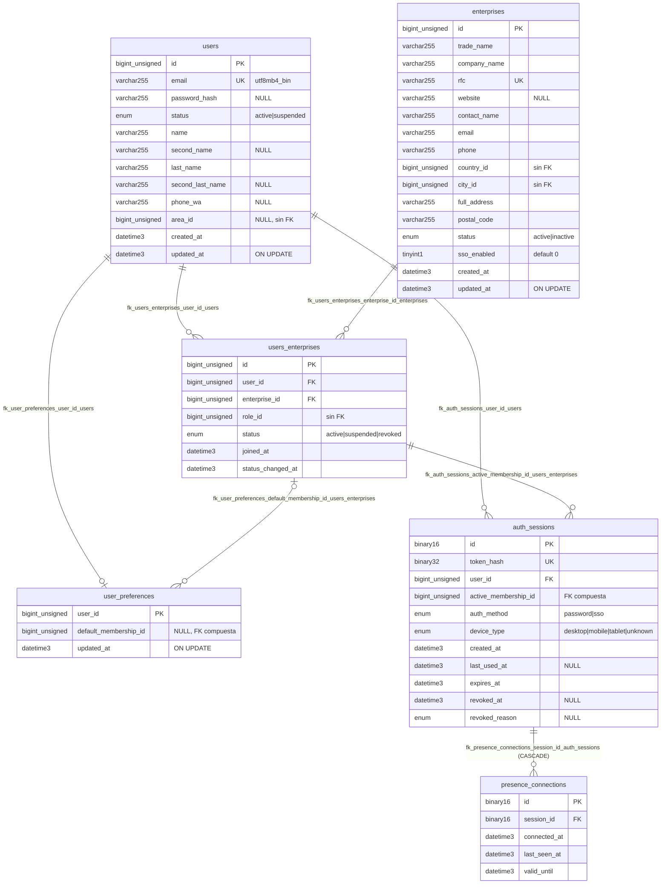

# NEXUS ERP · Login · login-04-migracion · v2

| Campo | Valor |
|---|---|
| Tarea | `login-04-migracion` (parte 3 del módulo de Login) |
| Versión | v2 |
| Fecha | 2026-11-20 |
| Estado | **Implementado, pendiente de revisión** |
| Rama / PR | `worktree/claude_worktree` · sin commits ni PR, por instrucción del responsable |
| Reemplaza a | `NEXUS ERP · Login · login-04-migracion · v1` |
| Fuente | `docs/iterations/login-04-migracion/claude.md`, sección "Registro de entrega" |

## 1. Cambios respecto a v1

- Modelos y migración `0001` implementados y verificados contra MySQL 8.4.13.
- **Ajustes de la revisión a mano de la migración generada:**
  - Orden de creación según la especificación.
  - `downgrade()` elimina solo las tablas: el `DROP INDEX` previo fallaba con el error 1553 de MySQL en índices que respaldan FK.
  - `sso_enabled` como `Boolean`: sigue siendo `tinyint(1)` en MySQL, sin el aviso de "display width" deprecado.
- Verificaciones V-01 a V-10 con resultados reales.

## 2. Objetivo y alcance

Sin cambios respecto a v1.

**Archivos entregados:**
- `app/identity/login/infrastructure/persistence/models.py`.
- `app/identity/login/infrastructure/persistence/__init__.py`.
- `alembic/versions/0001_login_base.py`.
- `app/core/db.py`: solo `import_models()`.

## 3. Diagrama ER tal como queda en la migración

## 4. Restricciones e índices, con su regla

| Nombre | Definición | Regla |
|---|---|---|
| `uq_users_email` | `users(email)` | LOG-07 |
| `ck_users_email_normalized` | `email = LOWER(TRIM(email))` | LOG-07, M-5 |
| `ix_users_area_id` | sin FK | M-1 |
| `uq_enterprises_rfc` | `enterprises(rfc)` | LOG-01 |
| `ix_enterprises_country_id`, `ix_enterprises_city_id` | sin FK | M-1 |
| `uq_users_enterprises_user_id_enterprise_id` | `(user_id, enterprise_id)` | LOG-07, CA-05 |
| `uq_users_enterprises_id_user_id` | `(id, user_id)` | Destino de las FK compuestas |
| `fk_users_enterprises_user_id_users`, `fk_users_enterprises_enterprise_id_enterprises` | RESTRICT | LOG-02, LOG-15 |
| `ix_users_enterprises_user_id_status_joined_at` | `(user_id, status, joined_at)` | LOG-05 |
| `ix_users_enterprises_enterprise_id_status` | `(enterprise_id, status)` | CU-07 a CU-10 |
| `ix_users_enterprises_role_id` | sin FK | M-1 |
| `fk_user_preferences_user_id_users` | RESTRICT | LOG-04 |
| `fk_user_preferences_default_membership_id_users_enterprises` | `(default_membership_id, user_id) → users_enterprises(id, user_id)` | LOG-04, LOG-05 |
| `uq_auth_sessions_token_hash` | SHA-256 del token | Instrucción general §3.1 |
| `fk_auth_sessions_user_id_users` | RESTRICT | LOG-03, LOG-16 |
| `fk_auth_sessions_active_membership_id_users_enterprises` | `(active_membership_id, user_id) → users_enterprises(id, user_id)` | LOG-16, CU-06 |
| `ix_auth_sessions_active_membership_id_revoked_at_expires_at` | | LOG-16, CU-11 |
| `ix_auth_sessions_user_id_revoked_at` | | LOG-15 |
| `ck_auth_sessions_revocation_consistent` | `(revoked_at IS NULL) = (revoked_reason IS NULL)` | LOG-14, LOG-16 |
| `ck_auth_sessions_expires_after_created` | `expires_at > created_at` | LOG-16 |
| `fk_presence_connections_session_id_auth_sessions` | CASCADE | CU-10 |
| `ix_presence_connections_session_id_valid_until` | | CU-08, CU-09 |
| `ix_presence_connections_valid_until` | | CU-09 (limpieza) |
| `ck_presence_connections_valid_after_connected` | `valid_until >= connected_at` | CU-07 |

Además, MySQL crea índices implícitos para las dos FK compuestas, con el nombre de cada FK. `alembic check` no los reporta como diferencia.

## 5. Decisiones

| ID | Estado |
|---|---|
| M-1 a M-3, M-5 | Aprobadas e implementadas. |
| M-4 | Aprobada: todos los `VARCHAR` en 255. **Provisional:** `full_address` bajó de 500 a 255 respecto a la especificación. |

## 6. Verificaciones ejecutadas y resultados reales

MySQL 8.4.13 en un contenedor desechable (puerto 3307), eliminado al terminar.

| # | Resultado |
|---|---|
| V-01 ruff | OK |
| V-02 mypy | OK (18 archivos) |
| V-03 `lint-imports` | OK, 4 de 4 |
| V-04 SQL sin base | OK: 6 tablas + `alembic_version`, 10 índices, 7 FK, 4 CHECK, collations correctas |
| V-05 nombres ≤ 64 | OK (máximo 59) |
| V-06 ida y vuelta | OK, dos veces, sin avisos |
| V-07 `alembic check` | OK: `No new upgrade operations detected.` |
| V-08 `SHOW CREATE TABLE` | Coincide con la especificación |
| V-09 integridad (Ana, Bruno, Saga, Mega) | **16/16 como se esperaba**: UK, CHECK, FK compuestas, RESTRICT, CASCADE y `ON UPDATE` |
| V-10 pytest | Sin pruebas todavía; sin regresiones |

## 7. Pendientes y traspaso a Codex

- **Codex:**
  - Revisar la propuesta y la entrega frente a `herdr-login-04-migraciones.md`.
  - Los nombres exactos de tablas, columnas, ENUM y restricciones están en `docs/iterations/login-04-migracion/claude.md`, sección 4.
  - Los 16 casos de V-09 pueden convertirse en pruebas de integración cuando se autorice esa tarea.
- **Responsable:**
  - Confirmar M-4 antes de producción.
  - Decidir cómo `login-07-sso` identifica la empresa, porque no hay un código corto.
  - Autorizar el commit en dos partes: `login-02-base` y `login-04-migracion`.
- **Siguientes partes:** generación de UUIDv7 para los `BINARY(16)` (tarea que inserte sesiones), FK hacia catálogos (módulo de catálogos) y `login-03-dominio`, que sigue pendiente.
