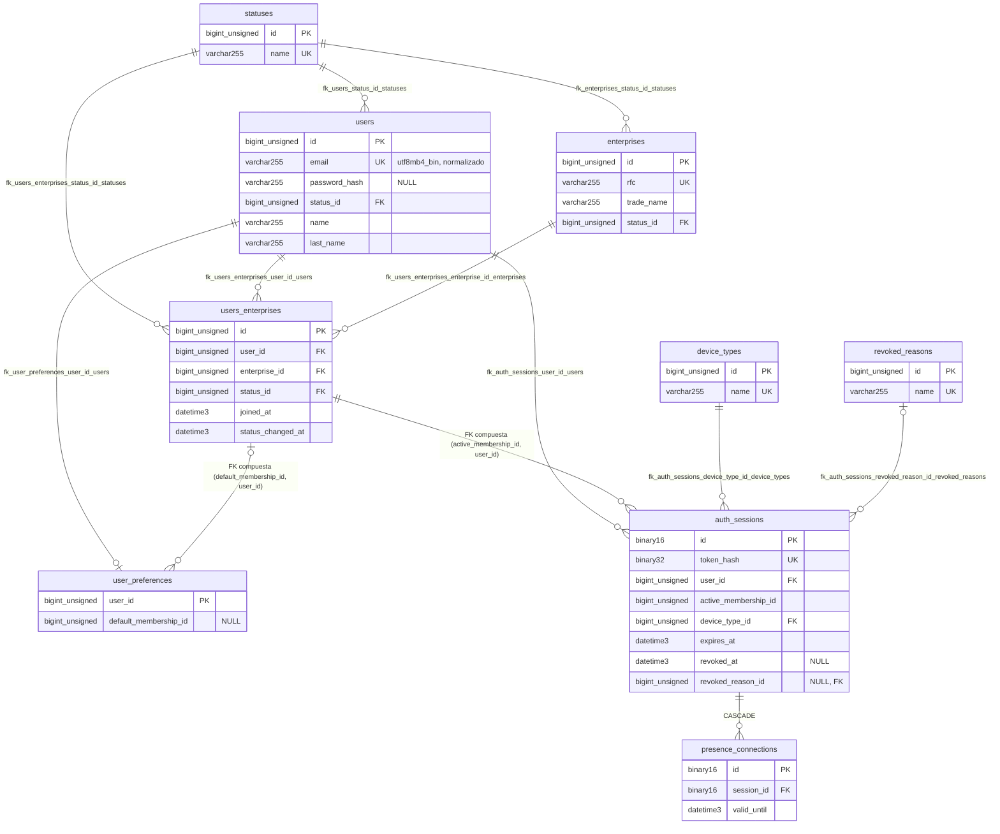

# NEXUS ERP · Login · login-04-migracion · v3

| Campo | Valor |
|---|---|
| Tarea | `login-04-migracion`, revisión R2 |
| Versión | v3 |
| Fecha | 2026-11-23 |
| Estado | **Implementado, pendiente de revisión** |
| Rama / PR | `worktree/claude_worktree` (base `e1563c8`) · sin commit ni PR |
| Reemplaza a | `NEXUS ERP · Login · login-04-migracion · v2` |
| Fuente | `docs/iterations/login-04-migracion/claude-r2.md` (propuesta aprobada y sección 7, registro de entrega) |

## 1. Cambios respecto a v2

| Id | Decisión del responsable (2026-11-23) | Efecto en el esquema |
|---|---|---|
| R2-01 | Quitar lo que aún no tiene información | Fuera `users.area_id`, `enterprises.country_id` y `enterprises.city_id`; M-1 queda sin objeto. |
| R2-02 | Sin roles por empresa por ahora | Fuera `users_enterprises.role_id`. |
| R2-03 | SSO pospuesto | Fuera `enterprises.sso_enabled` y `auth_sessions.auth_method`; `enterprise_sso_config` sigue en `login-07-sso` (M-3). |
| R2-04 | Sin ENUM; estados `active` / `inactive` en `statuses` | `status_id` con FK en `users`, `enterprises` y `users_enterprises`. |
| R2-05 | `device_type` y `revoked_reason` como catálogos | Tablas `device_types` y `revoked_reasons`; columnas `device_type_id` y `revoked_reason_id`. |
| R2-06 | Búsqueda por nombre | `UNIQUE(name)` en los tres catálogos. |
| R2-07 | `password_hash` sigue opcional | Sin cambio. |
| R2-08 | Se rehace `0001`, no se crea `0002` | Una sola migración limpia. |

Además, sin `server_default` en las FK hacia catálogos: la aplicación siempre envía el `id`, resuelto por `name`. Siguen vigentes M-4 (`VARCHAR(255)`) y M-5 (`ck_users_email_normalized`).

## 2. Objetivo y alcance

Modelos de persistencia y migración reversible `0001` con **9 tablas**: 3 catálogos y 6 de Login.

**Fuera del alcance:** repositorios, casos de uso, endpoints, áreas, países, ciudades, roles, SSO y ENUM.

## 3. Diagrama ER

Todas las tablas tienen `created_at` y/o `updated_at` en `DATETIME(3)` UTC; los catálogos tienen ambas.

## 4. Datos iniciales

| Tabla | Filas (`id` · `name`) |
|---|---|
| `statuses` | 1 · active, 2 · inactive |
| `device_types` | 1 · unknown, 2 · desktop, 3 · mobile, 4 · tablet |
| `revoked_reasons` | 1 · logout, 2 · switched, 3 · user_inactive, 4 · membership_inactive, 5 · enterprise_inactive, 6 · admin |

## 5. Restricciones e índices, con su regla

| Nombre | Regla |
|---|---|
| `uq_statuses_name`, `uq_device_types_name`, `uq_revoked_reasons_name` | R2-06 (búsqueda por nombre) |
| `uq_users_email`, `ck_users_email_normalized` | LOG-07, M-5 |
| `fk_users_status_id_statuses` + `ix_users_status_id` | LOG-15 (usuario inactivo) |
| `uq_enterprises_rfc` | LOG-01 |
| `fk_enterprises_status_id_statuses` + `ix_enterprises_status_id` | LOG-16 (empresa inactiva) |
| `uq_users_enterprises_user_id_enterprise_id` | LOG-07, CA-05 |
| `uq_users_enterprises_id_user_id` | Destino de las FK compuestas |
| `fk_users_enterprises_user_id_users`, `fk_users_enterprises_enterprise_id_enterprises` | LOG-02, LOG-15 |
| `fk_users_enterprises_status_id_statuses` + `ix_users_enterprises_status_id` | LOG-15, LOG-16 |
| `ix_users_enterprises_user_id_status_id_joined_at` | LOG-05 (membresía activa más antigua) |
| `ix_users_enterprises_enterprise_id_status_id` | CU-07 a CU-10 (directorio por empresa) |
| `fk_user_preferences_user_id_users` | LOG-04 |
| `fk_user_preferences_default_membership_id_users_enterprises` | LOG-04, LOG-05 |
| `uq_auth_sessions_token_hash` | Instrucción general §3.1 (solo se guarda el hash) |
| `fk_auth_sessions_user_id_users` | LOG-03, LOG-16 |
| `fk_auth_sessions_active_membership_id_users_enterprises` | LOG-16, CU-06 |
| `fk_auth_sessions_device_type_id_device_types` + `ix_auth_sessions_device_type_id` | R2-05 (solo informativo) |
| `fk_auth_sessions_revoked_reason_id_revoked_reasons` + `ix_auth_sessions_revoked_reason_id` | LOG-14, LOG-16 |
| `ix_auth_sessions_active_membership_id_revoked_at_expires_at` | LOG-16, CU-11 |
| `ix_auth_sessions_user_id_revoked_at` | LOG-15 |
| `ck_auth_sessions_revocation_consistent` (`revoked_at` ↔ `revoked_reason_id`) | LOG-14, LOG-16 |
| `ck_auth_sessions_expires_after_created` | LOG-16 |
| `fk_presence_connections_session_id_auth_sessions` (CASCADE) | CU-10 |
| `ix_presence_connections_session_id_valid_until`, `ix_presence_connections_valid_until` | CU-08, CU-09 |
| `ck_presence_connections_valid_after_connected` | CU-07 |

Todas las FK son `RESTRICT`, salvo la de `presence_connections`. MySQL mantiene un índice implícito para cada una de las dos FK compuestas.

## 6. Verificaciones ejecutadas y resultados reales

MySQL 8.4 en un contenedor desechable (puerto 3307), eliminado al terminar.

| # | Resultado |
|---|---|
| V-01 ruff | OK (tras corregir una línea larga en el docstring) |
| V-02 mypy | OK |
| V-03 `lint-imports` | OK, 4 de 4 |
| V-04 SQL sin base | 10 `CREATE TABLE`, 12 `INSERT` de catálogos (uno por fila en modo `--sql`), **0 ENUM**, sin columnas retiradas |
| V-05 nombres ≤ 64 | OK (máximo 59) |
| V-06 ida y vuelta | OK, dos ciclos, sin avisos |
| V-07 `alembic check` | `No new upgrade operations detected.` |
| V-08 `SHOW CREATE TABLE` (9 tablas) | Coincide con la especificación |
| V-09 integridad (Ana, Bruno, Saga, Mega) | **24/24 como se esperaba**, incluidos `status_id = 99` (1452), borrar `active` en uso (1451), `active` duplicado (1062), `revoked_at` sin motivo (3819) y `device_type_id` inexistente (1452) |
| V-10 pytest | Sin pruebas todavía |
| V-11 catálogos | Filas exactas de la sección 4 |

## 7. Pendientes y traspaso a Codex

- **Codex:**
  - Revisar la entrega frente a `herdr-login-04-r2-migraciones.md`, sección 4.
  - Los nombres exactos están en `claude-r2.md`, sección 7.5.
  - Los 24 casos de V-09 pueden convertirse en pruebas de integración cuando se autorice esa tarea.
- **Impacto en `login-03-dominio`:** los estados pasan a `active` e `inactive`. "Suspendido" y "revocado" se tratan como `inactive` (claude-r2, sección 3).
- **Menores:**
  - El docstring de `import_models()` aún dice "6 tablas"; no se tocó porque `db.py` estaba fuera del alcance.
  - `docker-compose.yml` ahora está en `.gitignore`, pero el README lo menciona.
  - Los commits de `develop` no se trajeron a esta rama.
- **Bitácora:** BIT-0003 la registra Claude al revisar.
